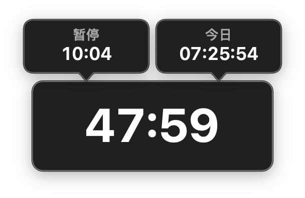
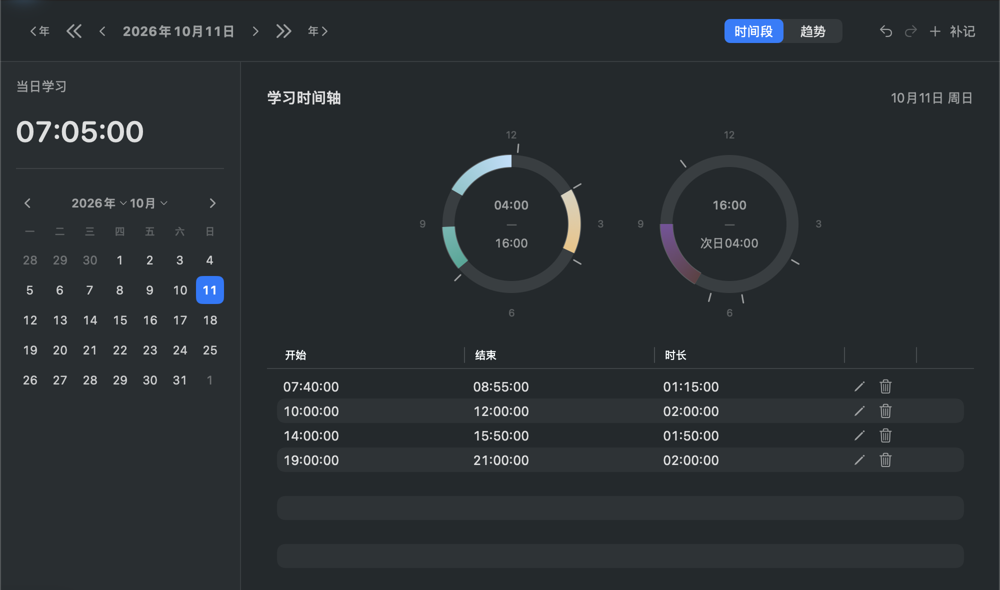
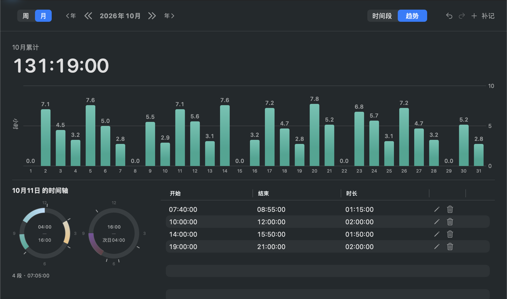
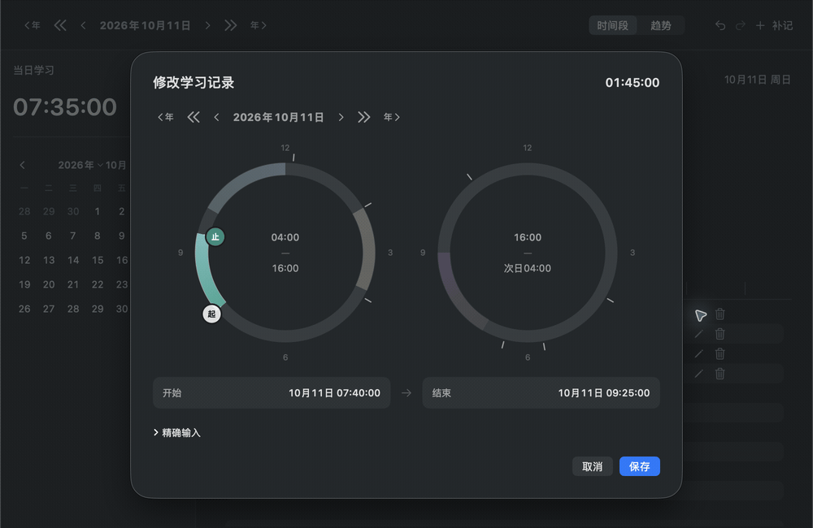

# StudyTimer · 学习计时器

macOS 原生悬浮学习计时器。支持正计时、倒计时、双圆环时间轴、拖动编辑和本地备份，无需账号，学习记录保存在本机。

**[下载 Mac 安装包](https://github.com/Harry6400/study-timer/releases/latest/download/StudyTimer-macOS-arm64.dmg)** · [ZIP 下载](https://github.com/Harry6400/study-timer/releases/latest/download/StudyTimer-macOS-arm64.zip) · [全部版本](https://github.com/Harry6400/study-timer/releases) · [SHA-256 校验值](https://github.com/Harry6400/study-timer/releases/latest/download/SHA256SUMS.txt)

需要 **Apple Silicon（M 系列）Mac、macOS 26 或更高版本**。

## v0.1.1 更新

- 每天凌晨 **04:00 自动结算并停止计时**，清除暂停计时和旧倒计时目标，主读数回到 `00:00`。睡眠或重启跨日后也会处理。
- 重新打开统计、从最小化恢复，或直接切换到“时间段”时，自动定位当前学习日。
- 近 7 天、当周和月趋势支持悬停查看下方当天详情；移出图表后保留该日，点击历史日期列仍可进入时间段。

## 界面演示

以下截图和动图均使用隔离演示数据。动图采用真实操作关键帧，停留时间经过调整。

### 悬浮计时

可拖动、缩放和置顶；暂停时出现临时计时小框，今日累计也可独立显示。



### 双圆环时间轴

左环显示 04:00–16:00，右环显示 16:00–次日 04:00。学习时段按时刻渐变着色，日期导航、日历和记录表共同定位某一天。



### 周月趋势

可查看近 7 天、当周或整月累计。每根柱子显示当天学习小时数，鼠标移到日期列时，下方圆环和记录列表立即显示当天数据；移出后仍保留该日，方便继续查看或编辑。点击历史日期列可进入当日时间段；未来日期只显示空预览，不能跳转或补记。



### 拖动编辑

拖动起止手柄调整时间，也可平移整段记录；保存后支持撤销与重做。按住 Option 可细调到秒。



## 下载与安装

1. 下载上方 DMG，打开后将 `StudyTimer.app` 拖入 Applications（应用程序）；也可以下载 ZIP 后解压并移入“应用程序”。
2. 打开应用，单击悬浮读数展开控制面板。
3. 当前下载版采用本地签名，**未经过 Apple 公证**。首次打开若被系统拦截，可在确认下载来源和校验值后，按 [Apple 官方说明](https://support.apple.com/en-us/102445)进入“系统设置 → 隐私与安全 → 仍要打开”。

如需校验下载文件，将安装包与 `SHA256SUMS.txt` 放在同一目录：

```sh
shasum -a 256 -c SHA256SUMS.txt --ignore-missing
```

更新前先退出旧版，再替换应用。学习记录与设置存储在应用包之外，正常替换应用会保留这些数据。

## 使用

- 在控制面板输入 `0` 并回车，开始正计时。
- 输入 `5` 开始五分钟倒计时，也支持 `25:00`、`1:30:00`。
- 暂停不计入学习时长，继续后产生新的学习时段。暂停小框只临时显示，不写入历史；继续、重置、重开应用或凌晨 04:00 结算后清除。
- 中部拖动悬浮窗，边缘调整大小；面板中可切换置顶、外观及今日累计小框。
- 学习统计可查看单日时间段和周／月趋势。打开统计或直接切换到“时间段”时，选择当前学习日；手动点击历史柱子时进入所选日期。记录支持补记、修改和删除；正在计时的记录需要先暂停。
- 本次运行内保留最近 **20 步**记录撤销／重做。重开应用或恢复备份后清空操作历史。

凌晨 **04:00** 是学习日边界，例如凌晨 01:00 仍属于前一个学习日；一周从周一开始。

到达 04:00 时，应用将当前学习时段保存到该边界，然后停止计时，主读数归零为 **`00:00`**。已暂停或已完成的读数也会清零，暂停计时和旧倒计时目标一并清除，历史记录继续保留。倒计时若更早结束，只记录到原定结束时刻。

计时使用连续时钟，锁屏与休眠仍会累计，但最晚计到该学习日结束。电脑睡眠跨过 04:00 时，唤醒后先结算；应用关闭跨日时，下次启动清除旧读数。退出应用会保存并暂停，同一学习日重开后可手动继续。倒计时在休眠期间结束时，系统提醒可能延后到唤醒。

### 应用内快捷键

| 快捷键 | 操作 |
|---|---|
| `⌘⇧P` | 暂停／继续；编辑和确认弹窗期间停用 |
| `⌘Z` | 撤销记录更改；文本输入时优先撤销文字 |
| `⇧⌘Z` | 重做记录更改 |
| `⌘1` | 打开学习统计 |
| `⌘,` | 打开设置 |

## 数据与备份

数据目录为 `~/Library/Application Support/StudyTimer/`，记录保存在 `history.sqlite3`，偏好使用 macOS 设置存储。

- 设置中可导出完整 JSON 备份或 CSV。JSON 保留记录、计时读数与偏好，CSV 按凌晨四点拆分学习日。
- 自动备份默认开启：保留最近 **7 个学习日**的每日备份，以及最近 **10 份**记录变更或恢复前快照，位于数据目录的“自动备份”文件夹。
- 每日备份在启动、跨日、暂停、完成、退出及记录变更后更新；持续计时期间每 30 分钟更新。
- 操作前备份失败时，不执行该次记录变更；普通每日备份失败不会停止计时。
- 日结算写入失败时，应用停止计时并保留待保存结果，提示原因；保存重试成功后才允许开始新计时。
- 恢复会替换现有数据，确认后先保存操作前快照。恢复后的计时保持暂停，记录撤销历史清空。
- 运行期间每 15 秒保存检查点。意外退出后恢复至最后检查点并暂停，可在统计页补记差额。

## 从源码构建

需要 Apple Silicon Mac、macOS 26+，以及包含 macOS 26 SDK 的 Xcode 26 或相应 Command Line Tools。

```sh
git clone https://github.com/Harry6400/study-timer.git
cd study-timer
./scripts/test.sh
./scripts/build-app.sh
```

构建脚本打印生成的 `.app` 路径，缓存和应用默认位于系统临时目录。确认旧版已退出后，可运行 `./scripts/build-app.sh --install` 安装到 `/Applications/StudyTimer.app`。

生成与校验下载包：

```sh
./scripts/package-release.sh 0.1.1
python3 scripts/verify-release.py dist --version 0.1.1
```

输出为 `dist/` 下的 DMG、ZIP 和校验值。可用 `STUDYTIMER_BUILD_ROOT`、`STUDYTIMER_RELEASE_DIR` 指定构建与打包目录。

开发与界面验证可使用独立数据目录：

```sh
open -n /path/to/StudyTimer.app --args --data-directory /tmp/studytimer-demo --statistics
```

同一数据目录仅允许一个实例。GitHub Actions 在主分支和 PR 执行测试与构建；推送与应用版本一致的 `v*.*.*` 标签，会生成下载包及草稿 Release，验收后再公开发布。

## 实现与验证

Swift 原生实现，使用 AppKit、SwiftUI 和系统 SQLite，无第三方运行时依赖。`StudyTimerCore` 包含计时、统计索引、记录操作历史与备份服务；`StudyTimer` 负责界面、菜单栏与系统通知。

当前包含 **73 项自动测试**，覆盖计时状态、凌晨四点分日与结算、模拟睡眠和重启跨日、增量统计、历史编辑、撤销重做、备份恢复与写入失败重试。统计日期导航、三种趋势的真实悬停、历史柱跳转、未来日期限制和最小窗口已在 Apple Silicon、macOS 26.6.2 上验收；跨日测试使用可控时钟，通知送达、真实休眠和跨屏等系统场景尚未完成全面实机验证。问题与反馈可提交到 [Issues](https://github.com/Harry6400/study-timer/issues)。

## 许可证

[MIT](LICENSE) © 2026 Harry6400。
